<p align="center">
  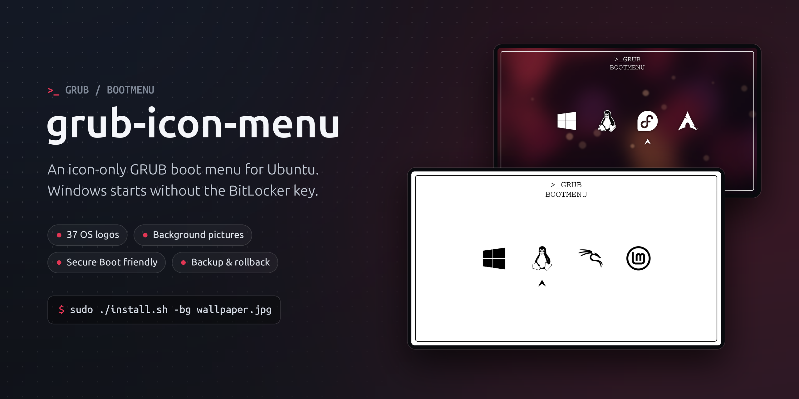
</p>

<h1 align="center">grub-icon-menu</h1>

<p align="center">
  <b>An icon-only GRUB boot menu for Ubuntu. The Windows icon starts Windows without the BitLocker recovery key.</b>
</p>

<p align="center">
  
  
  
  
  
  
</p>

<p align="center">
  <a href="#quick-start">Quick start</a> ·
  <a href="#screenshots">Screenshots</a> ·
  <a href="#installation">Install options</a> ·
  <a href="#windows-and-bitlocker">Windows &amp; BitLocker</a> ·
  <a href="#troubleshooting">Troubleshooting</a> ·
  <a href="docs/help.html">Offline help</a>
</p>

---

grub-icon-menu replaces Ubuntu's text boot menu with a quiet screen of logos. The
screen is white, or your own picture with `-bg`. A thin frame with rounded corners
holds the `>_GRUB / BOOTMENU` title, a **Windows** logo, a **Tux** for this Ubuntu
and the logo of every **other installed system**: Kali, Linux Mint, Arch, Fedora and
[many more](#other-systems-kali-linux-mint-arch-). An arrow marks the selected icon,
and the screen shows no OS names.

The Windows icon does not chainload Windows from GRUB. It asks the **UEFI firmware**
to start Windows, so **BitLocker does not ask for the recovery key**. See
[Windows and BitLocker](#windows-and-bitlocker) for how that works.

Every screenshot in this README is **real GRUB 2.14** running in a QEMU/OVMF
virtual machine (`tests/qemu-screenshots.sh`), not a mock-up.

## Contents

- [Highlights](#highlights)
- [Quick start](#quick-start)
- [Screenshots](#screenshots)
- [Requirements](#requirements)
- [Installation](#installation)
- [Using the menu](#using-the-menu)
- [Background pictures](#background-pictures)
- [Icons](#icons)
- [Other systems (Kali, Linux Mint, Arch, ...)](#other-systems-kali-linux-mint-arch-)
- [Windows and BitLocker](#windows-and-bitlocker)
- [Update, plain menu and uninstall](#update-plain-menu-and-uninstall)
- [Health check and help](#health-check-and-help)
- [How it works](#how-it-works)
- [Configuration file](#configuration-file)
- [Files and safety](#files-and-safety)
- [Backup and restore](#backup-and-restore)
- [Troubleshooting](#troubleshooting)
- [FAQ](#faq)
- [Project layout](#project-layout)
- [Development and tests](#development-and-tests)
- [Credits and licences](#credits-and-licences)

## Highlights

| | |
|---|---|
| 🖼️ **Icons only** | Windows, Tux and 37 icons for other systems. Each icon is rendered at the exact pixel size of your screen, so it stays sharp at any resolution. |
| 🔐 **BitLocker-safe Windows** | The firmware starts Windows through a one-time `BootNext`, so the TPM measures a normal Windows boot and BitLocker does not ask for the key. |
| 🌄 **Your own background** | Any JPEG, PNG or WebP. It is cropped to fill the screen. Icon colour (black or white) and a soft shadow are chosen automatically. |
| 🧭 **Finds other systems** | Systems with their own UEFI boot entry (Kali, Fedora, Arch, ...) are found automatically. Systems that share Ubuntu's boot folder (Linux Mint, Zorin, ...) are found with `--os-prober`. |
| 🛟 **Nothing is lost** | ESC opens the full Ubuntu menu: advanced options, recovery mode, memory test and UEFI settings. Kernel updates, `savedefault` and recovery work as before. |
| ♻️ **Safe to try** | `--dry-run`, a backup snapshot before every change, automatic rollback on failure and a one-command restore. |
| 🩺 **Health check** | `doctor.sh` checks boot order, `BootNext`, signed kernels, pending BIOS updates and more, and prints the command that fixes each problem. |
| 🧪 **Tested in real GRUB** | Fast unit tests, a sandbox that runs the real `update-grub`, and QEMU tests with Secure Boot and a TPM that compare the PCR values. |

## Quick start

```bash
# 1. Dependencies (Ubuntu)
sudo apt install grub-common imagemagick file fontconfig python3 gzip busybox-static efibootmgr

# 2. Get the code
git clone <this repository> grub-icon-menu
cd grub-icon-menu

# 3. Look first: read-only report, then a full simulation that changes nothing
sudo ./inspect.sh
sudo ./install.sh --dry-run

# 4. Install (white screen), or with your own picture
sudo ./install.sh
sudo ./install.sh -bg ~/Pictures/wallpaper.jpg

# 5. Reboot when you are ready (the installer never reboots)
sudo reboot
```

> [!TIP]
> Before you pick the Windows icon for the first time, check once that your firmware
> honours `BootNext`. See the short test in [Windows and BitLocker](#windows-and-bitlocker).

> [!IMPORTANT]
> Keep your **BitLocker recovery key** somewhere outside the laptop (your Microsoft
> account at <https://aka.ms/myrecoverykey>, or on paper). This tool avoids the
> recovery prompt, but a BIOS update or a change to the Secure Boot settings can still
> trigger it, as it would without Ubuntu.

## Screenshots

| Ubuntu is the default (arrow under Tux) | Down → Windows |
|---|---|
|  | 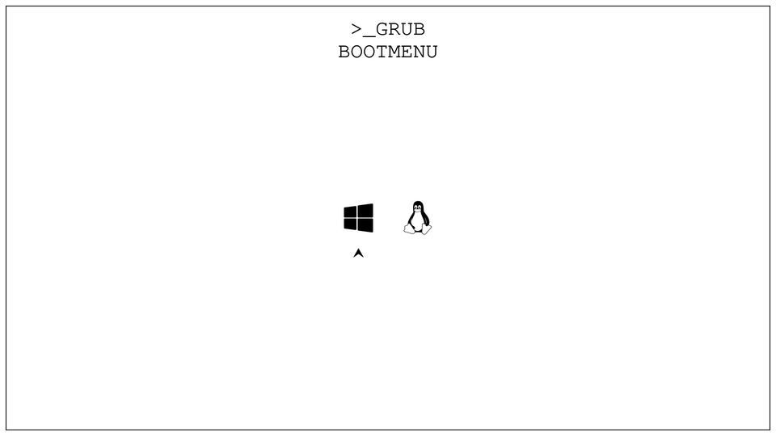 |

| Down again → wraps back to Ubuntu | Up → Windows |
|---|---|
| 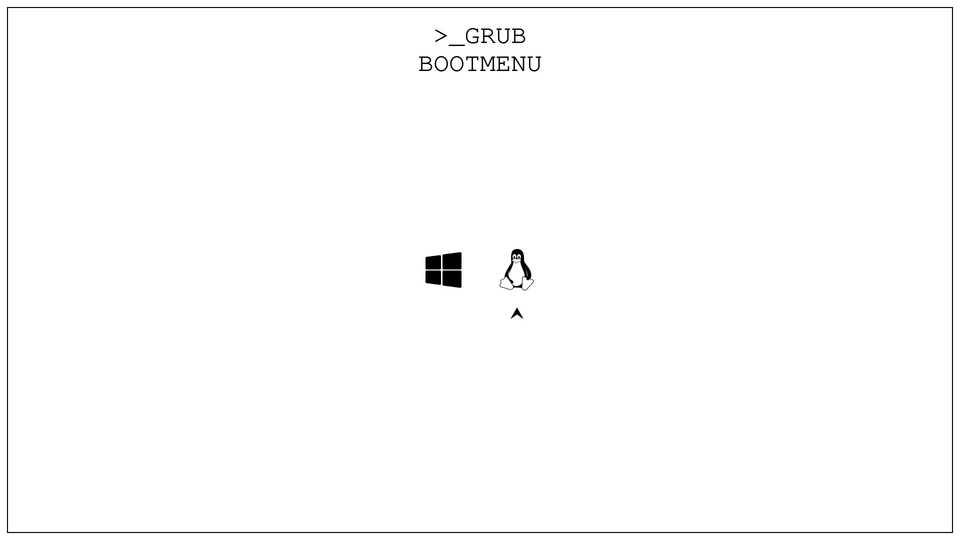 |  |

| ESC → full menu (fallback, names visible) | Installed with `-rt` (no title text) |
|---|---|
| 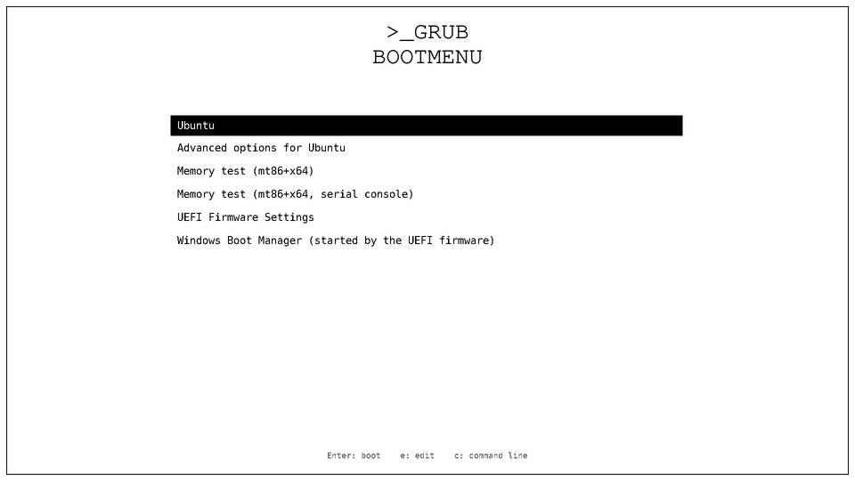 | 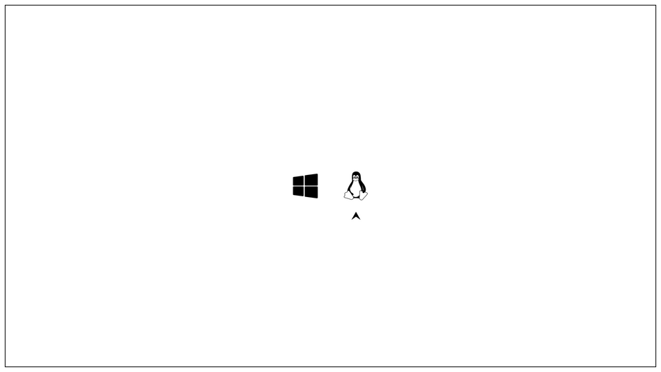 |

### With a background picture (`-bg`)

| Dark picture → white icons, soft shadow | Up → Windows |
|---|---|
| 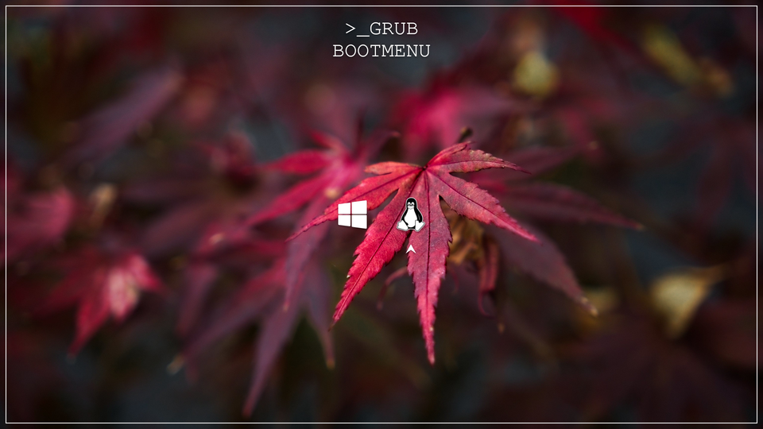 | 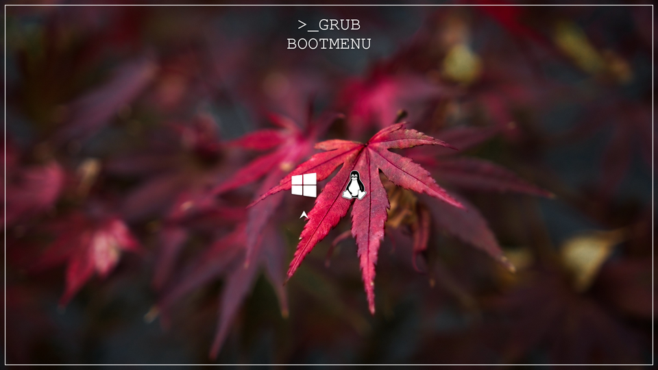 |

| Light picture → black icons | ESC → full menu on the picture |
|---|---|
| 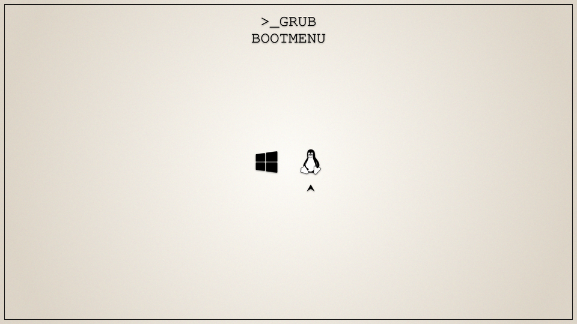 | 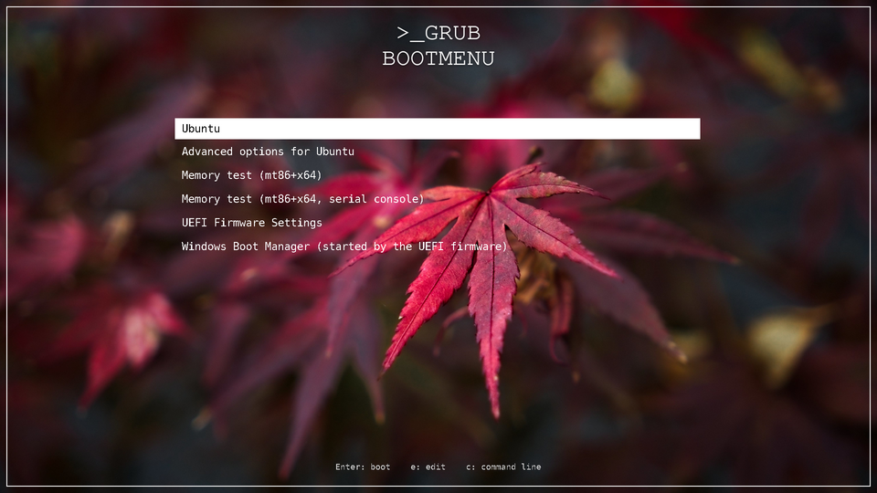 |

| Plain text menu (`update.sh --plain`) | |
|---|---|
| 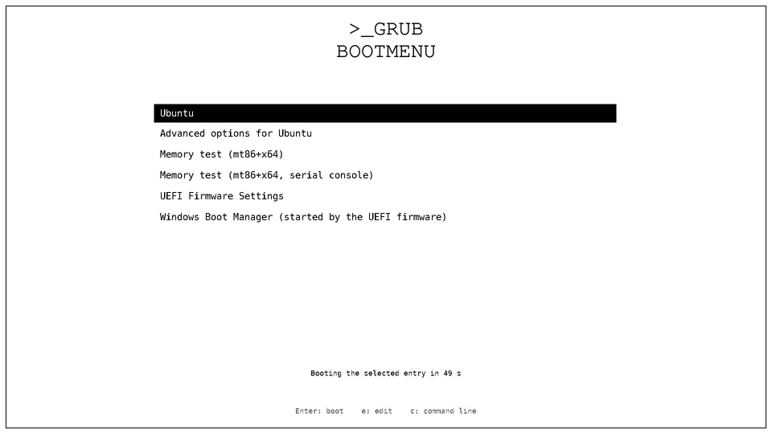 | |

### More systems: Kali and Linux Mint next to Windows and Ubuntu

| Four icons, found automatically | Dark picture, Down → Kali |
|---|---|
| 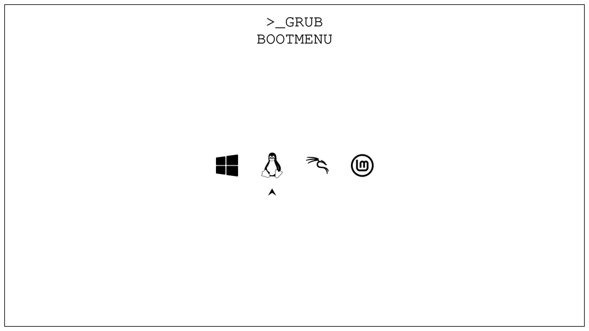 | 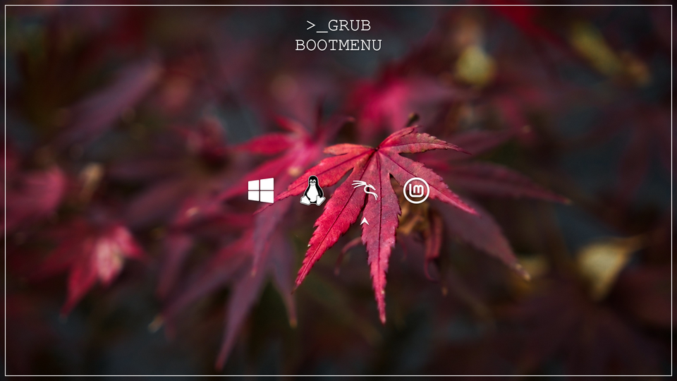 |

| ESC → full menu: Kali and Windows are started by the firmware | |
|---|---|
| 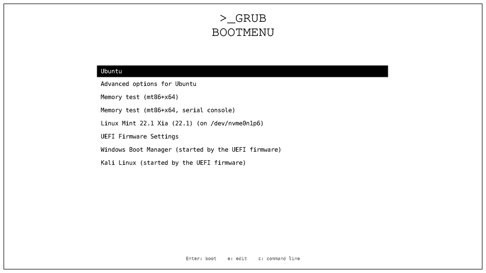 | |

### Sharpness

Real GRUB pixels, enlarged 3× without smoothing, on the white screen, a dark picture
and a light picture:

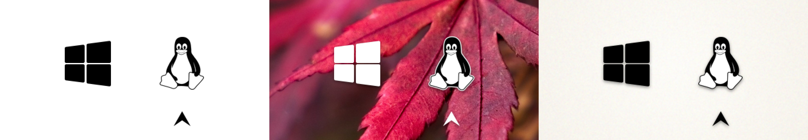

The dark screenshots use *Red Acer* by mendhak (an Ubuntu wallpaper, CC BY-SA 4.0) as
the background. The light one is a generated paper gradient.

## Requirements

| | |
|---|---|
| **System** | Ubuntu, with GRUB as the boot loader. The installer stops if `/etc/os-release` does not identify Ubuntu. Developed and tested on Ubuntu 26.04 with GRUB 2.14. |
| **Firmware** | UEFI. Secure Boot may be on. The Windows firmware handoff and the systems started by the firmware need UEFI boot entries. |
| **GRUB terminal** | Graphical (`gfxterm`, Ubuntu's default). The installer stops if `GRUB_TERMINAL` or `GRUB_TERMINAL_OUTPUT` is set to anything else, such as `console`. |
| **Disk** | About 1 MB for `handoff.img`, plus the theme (larger with a background picture) in `/boot`. |

Packages:

| Package | Needed for |
|---|---|
| `grub-common` | `grub-mkconfig`, `grub-script-check`, `grub-probe`, `grub-mkfont` (installed with Ubuntu) |
| `imagemagick` | rendering the theme, the icons and the background |
| `file`, `fontconfig` | checking the generated files, finding the title and menu fonts |
| `python3`, `gzip`, `busybox-static` | building `handoff.img` for the Windows icon (firmware mode, the default) |
| `os-prober` | optional, only with `--os-prober` |
| `efibootmgr` | optional, used by `doctor.sh` and for the manual `BootNext` test |
| `fwupd` | optional, `doctor.sh` uses it to warn about pending BIOS updates |
| `librsvg2-bin`, `python3-pil` | development only: re-rendering icon masters, wallpapers and the cover |

## Installation

```bash
cd grub-icon-menu
sudo ./install.sh                         # white screen, ">_GRUB / BOOTMENU" title
sudo ./install.sh -rt                     # without the title text
sudo ./install.sh -bg ~/Pictures/x.jpg    # with a background picture
sudo ./install.sh --dry-run               # build and simulate everything, change nothing
```

The installer does the following, in order:

1. Inspects the system: Ubuntu version, GRUB version, boot mode, Secure Boot, Windows
   on the EFI partition and in the UEFI boot entries, and other systems.
2. Builds the theme for your screen in a temporary folder: icons, arrow, frame, title
   font, background and `handoff.img`.
3. Simulates the new `grub.cfg` and checks it with `grub-script-check`.
4. Shows a summary and asks for confirmation (skip it with `--yes`).
5. Saves a backup snapshot, installs the hook, theme and settings, runs `update-grub`
   and validates the result. **If any step fails, everything is rolled back.**

Reboot yourself afterwards. The installer never reboots.

### Options

| Option | Meaning |
|---|---|
| `-rt`, `--remove-title` | hide the `>_GRUB / BOOTMENU` text |
| `-bg FILE`, `--background FILE` | background picture instead of the white screen |
| `--icon-color auto\|black\|white` | colour of icons, arrow, title and frame (default `auto`) |
| `--shadow auto\|on\|off` | soft shadow under icons and title (default: on with a picture) |
| `--timeout N` | seconds before the selected OS boots (default `10`; `-1` waits forever) |
| `--resolution WxH` | screen size to build the theme for (default: `GRUB_GFXMODE` if set, otherwise the native panel resolution) |
| `--windows-boot firmware` | (default) the Windows icon lets the UEFI firmware start Windows, so there is no BitLocker recovery prompt |
| `--windows-boot chainload` | GRUB starts Windows itself. BitLocker asks for the recovery key every time. |
| `--no-os-prober` | chainload mode only: do not enable Windows detection |
| `--os-prober` | also find systems on other partitions that share Ubuntu's boot folder (Linux Mint, Zorin, ...). Windows stays skipped. |
| `--dry-run` | inspect, build and simulate everything in a temporary folder and print the GRUB script that would be added. Nothing is changed. |
| `--yes`, `-y` | do not ask for confirmation |
| `-h`, `--help` | show the built-in help |

## Using the menu

| Key | Action |
|---|---|
| **Up / Down** | move the arrow. It **wraps around** from the last icon to the first. |
| **Enter** | boot the selected OS (Windows: see [Windows and BitLocker](#windows-and-bitlocker)) |
| **ESC** | full menu: advanced options, recovery mode, memory test, UEFI settings |
| `e` / `c` | edit the entry / open the GRUB command line |

The memory test, *Advanced options for Ubuntu* and the other extra entries never get
the arrow. They are only in the ESC menu.

> [!NOTE]
> GRUB hard-codes its menu keys. **Left does nothing and Right boots the selected OS**
> (like Enter). A theme cannot change this, so use Up and Down to move.

The preselected icon is the one of GRUB's default entry, usually Ubuntu (Tux), and it
boots when the timeout runs out. If the default is a pinned older kernel, the Tux
boots that kernel.

## Background pictures

```bash
sudo ./install.sh -bg ~/Pictures/wallpaper.jpg        # when installing
sudo ./update.sh  -bg ~/Pictures/other.png            # change it later
sudo ./update.sh  -bg none                            # white screen again
```

* **Any format ImageMagick reads** (JPEG, PNG, WebP, ...). The picture is scaled to
  **cover** the screen: the aspect ratio is kept, the picture is centred and the
  overflow is cut off. It is stored as a lossless PNG of exactly the screen size, so
  GRUB shows it without scaling.
* **Icon colour** is chosen from the brightness behind the icons: `--icon-color auto`
  (default), `black` or `white`.
* **Shadow:** with a picture, the icons, arrow and title get a soft shadow so they stay
  readable on busy pictures: `--shadow auto` (default), `on` or `off`.
* The frame, the title, the full menu (ESC) and the screen shown while the chosen OS
  loads all use the picture and the same colour.
* **Best results:** a picture with a calm area in the middle, where the icons are.
* A copy of the picture is kept in `/var/lib/grub-icon-menu/background.<ext>`, so
  `update.sh` can rebuild the theme later (new resolution, new version) even if the
  original file is moved or deleted.

**Ready-made wallpapers:** [`wallpapers/`](wallpapers/) has soft neumorphic 1920x1080
backgrounds (lavender capsules, white capsules, white bubbles, white tiles). They are
made by `python3 wallpapers/generate.py` (Pillow only).

```bash
sudo ./update.sh -bg wallpapers/07-white-bubbles.png
```

### Which picture size to use

Use a picture with the **same resolution as the screen**. For a 1920x1080 (16:9)
screen, the best picture is 1920x1080. A larger 16:9 picture, such as 2560x1440 or
3840x2160 (4K), also works and stays sharp.

| Screen resolution | Best picture size | Shape |
|---|---|---|
| 1366x768 | 1366x768 or larger 16:9 (1920x1080) | 16:9 |
| **1920x1080** | **1920x1080**, or 2560x1440 / 3840x2160 | 16:9 |
| 1920x1200 | 1920x1200 or larger 16:10 | 16:10 |
| 2560x1440 | 2560x1440 or 3840x2160 | 16:9 |
| 2560x1600 | 2560x1600 or larger 16:10 | 16:10 |
| 3840x2160 (4K) | 3840x2160 | 16:9 |

* **Same size or larger:** sharp. A larger picture is reduced to the screen size.
* **Smaller:** the picture is enlarged and looks soft or blurry. The installer warns
  when it has to enlarge a picture by more than 10 %. For example, a 1280x720 picture
  on a 1920x1080 screen gets that warning.
* **Different shape** (for example a 4:3 photo, 4000x3000, on a 16:9 screen): it still
  fills the whole screen, but the parts that do not fit (here the top and bottom) are
  cut off. Keep the important part of the photo in the middle.
* **Portrait (tall) phone photos** lose most of their top and bottom. Landscape photos
  work better.

Check the sizes:

```bash
sed -n 's/^RESOLUTION=//p' /var/lib/grub-icon-menu/state   # screen size the theme is built for
identify -format '%wx%h\n' ~/Pictures/photo.jpg           # size of a picture
```

The screen size is also shown in *Settings → Displays → Resolution*. If you change
the theme's screen size later (`sudo ./update.sh --resolution 2560x1440`), the kept
copy of the picture is fitted again automatically.

## Icons

All icon sources are in [`icons/`](icons/). Sources and licences are listed in
[`icons/README.md`](icons/README.md). Every icon is made for the exact pixel size
it is shown at, so GRUB never scales them.

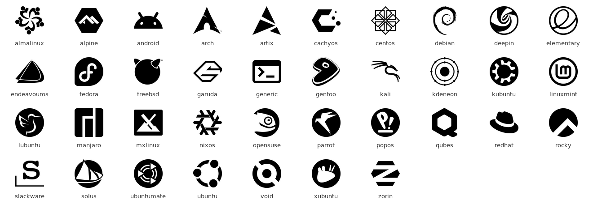

* **Tux:** the black-and-white Tux `icons/tux.svg` (Wikimedia Commons, CC0), rendered
  with librsvg into the 2048 px master `theme/tux.png` (`scripts/render-masters.sh`)
  and reduced to the final size.
* **Windows** and the **arrow:** drawn from the polygons in `icons/windows.svg` and
  `icons/arrow.svg`. The arrow is a vector trace of
  `icons/Minimalist Black Navigation Arrow.png`. The corners are snapped to the pixel
  grid, and each shape is drawn 8× larger and reduced by averaging, so the edges and
  the gaps of the Windows logo are crisp with no blur or halo.
* **Other systems** (Kali, Linux Mint, Arch, ... the sheet above): one-colour logos
  from [Simple Icons](https://simpleicons.org), `icons/os/<name>.svg`, rendered to
  1024 px PNG masters `icons/png/<name>.png` and reduced to the final size.
* **Colours:** black icons on light backgrounds and white icons on dark ones. On dark
  backgrounds the Tux keeps its black and white and gets a thin light outline.
* **Icon size:** set `ICON_SCALE` in `scripts/generate-assets.sh` (default `0.6`;
  `1.0` is the original, larger size). After changing it, run `sudo ./update.sh --rebuild`.
* **Adding a system:** see [*Adding a system*](icons/README.md#adding-a-system).

## Other systems (Kali, Linux Mint, Arch, ...)

Install another system next to Windows and Ubuntu, then run:

```bash
sudo ./update.sh        # finds it and adds its icon
```

How each kind of system is found and started:

| Kind of system | Found by | Started by | Examples |
|---|---|---|---|
| Has its **own UEFI boot entry** (its own folder in `\EFI\`) | reading the firmware boot entries; **always on** | the **firmware** (one-time `BootNext` + restart), exactly like the Windows icon and like the firmware boot menu. Secure Boot keeps working. | Kali (`\EFI\kali`), Fedora, Debian, openSUSE, Arch, Manjaro, Pop!_OS, NixOS, ... |
| Shares **Ubuntu's** boot folder `\EFI\ubuntu` | **os-prober** on the other partitions: `sudo ./update.sh --os-prober` | this GRUB, with the system's own kernel as os-prober sets it up | Linux Mint, Zorin OS, elementary OS, KDE neon, another Ubuntu |

* **New system without an icon yet:** until you run `update.sh`, a newly found system
  is already in the full menu (ESC), and `update-grub` prints *found without an icon
  yet*. `update.sh` builds its icon and puts it after the others.
* **At most 6 icons** fit in one row. Further systems stay in the ESC menu.
* **`--os-prober` and BitLocker:** this option switches os-prober on and puts Windows
  on `GRUB_OS_PROBER_SKIP_LIST`, so os-prober never creates a GRUB entry that starts
  Windows (that entry would ask for the recovery key). If one appears anyway,
  `update.sh` stops and puts everything back. `--no-os-prober` switches it off again.
* **Not shown:** this Ubuntu's own entry (it is the Tux), USB sticks, network boot,
  the fallback loader `\EFI\BOOT\`, inactive entries and vendor tools. A system with
  an unknown name gets no icon. If os-prober finds it, it gets the generic `>_` icon.
* **Removed systems** lose their icon at the next `update-grub`. The icon file stays in
  the theme, unused.
* **Order:** `GRUB_ICON_MENU_ORDER` in the [configuration file](#configuration-file)
  (default `windows linux`, then the others in the order they were found). The icon
  names are listed in [`icons/README.md`](icons/README.md#supported-systems).

<details>
<summary><b>All 37 icons for other systems</b></summary>

AlmaLinux · Alpine Linux · Android (Android-x86, Bliss OS) · Arch Linux · Artix Linux ·
CachyOS · CentOS · Debian · deepin · elementary OS · EndeavourOS · Fedora · FreeBSD ·
Garuda Linux · Gentoo · Kali Linux · KDE neon · Kubuntu · Linux Mint · Lubuntu ·
Manjaro · MX Linux · NixOS · openSUSE · Parrot OS · Pop!_OS · Qubes OS · Red Hat
Enterprise Linux · Rocky Linux · Slackware · Solus · Ubuntu (another one) · Ubuntu
MATE · Void Linux · Xubuntu · Zorin OS · and a generic `>_` icon for any other Linux.

</details>

## Windows and BitLocker

### Why GRUB cannot simply start Windows

BitLocker keeps its key in the TPM, sealed to measurements of the boot chain. On the
laptop this was developed on, those are PCR 0, 2, 4 and 11. PCR 4 holds the hash of
every program that boots:

* Windows started by the firmware is measured as *Windows Boot Manager*.
* Windows started by GRUB is measured as *shim + GRUB + Windows Boot Manager*.

The two do not match, so BitLocker asks for the recovery key. It asks **every time**,
not just once.

### What the Windows icon does instead

The Windows icon does **not** start Windows from GRUB. It boots the signed Ubuntu
kernel with a tiny program (`handoff.img`, about 1 MB, see
[`handoff/init`](handoff/init)). That program sets the one-time UEFI variable
`BootNext` to the firmware's own *Windows Boot Manager* entry and restarts. After the
restart, the firmware starts Windows exactly as it does without Ubuntu, so BitLocker
sees a normal Windows boot. The firmware deletes `BootNext` when it uses it, so the
next boot is normal again.

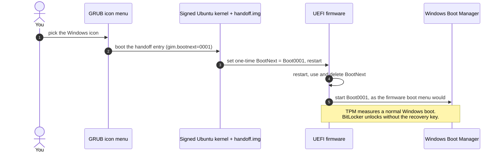

* **What you see:** the menu's background stays on screen for a few seconds, then the
  laptop restarts (the manufacturer logo appears) and Windows starts. The extra restart
  is the price of avoiding the key prompt: only the firmware can start Windows the way
  BitLocker expects.
* **Nothing else is changed:** no disk is mounted (the NVMe driver is not even in
  `handoff.img`), and `BootOrder` and the boot entries stay as they are.
* **Secure Boot safe:** the kernel used is the **newest signed** kernel in `/boot`, so
  installing an unsigned kernel (mainline or self-built) cannot break the Windows icon
  while Secure Boot is on.
* **Fails safe:** if something is unexpected (no *Windows Boot Manager* entry,
  `BootNext` cannot be set, or the firmware ignored the previous request), nothing is
  written. A message in a large font explains the problem. Enter restarts into the
  menu, and otherwise the laptop turns off after 60 s, so it can never loop.
* **No wrong path left:** GRUB's own chainload entry for Windows is removed
  (`GRUB_DISABLE_OS_PROBER=true` in the drop-in), so the ESC menu cannot start Windows
  the wrong way either.
* **Verified:** in a Secure Boot VM with a TPM (`tests/qemu-handoff-test.sh`), the
  handoff gives PCR 0, 2, 4 and 7 values identical to a normal firmware boot of Windows
  Boot Manager. With chainloading, PCR 4 and 7 differ.

### When BitLocker will still ask

These still make BitLocker ask for the key, as they would without Ubuntu:

* a **BIOS/UEFI update**
* changing **Secure Boot** or **TPM** settings in the BIOS

Suspend BitLocker in Windows before a BIOS update. `./doctor.sh` warns when fwupd
offers one. [docs/help.html](docs/help.html) explains what to do in each case.

### Test `BootNext` once by hand

Check once that your firmware honours `BootNext`. The firmware boot menu does the
same thing.

```bash
sudo efibootmgr                      # note the number of "Windows Boot Manager", e.g. 0001
sudo efibootmgr --bootnext 0001      # one-time: next boot only
sudo reboot                          # Windows should start without asking for the key
```

`sudo efibootmgr --delete-bootnext` cancels it before the reboot.

### Prefer the classic way?

`--windows-boot chainload` makes GRUB start Windows directly, the usual dual-boot
setup. Use it only if Windows does not use BitLocker or Device Encryption, because
with BitLocker it asks for the recovery key at every boot.

## Update, plain menu and uninstall

```bash
sudo ./update.sh                    # after adding/removing an OS or changing the screen
sudo ./update.sh -rt                # remove the title text
sudo ./update.sh --show-title       # bring the title back
sudo ./update.sh -bg FILE           # new background picture (-bg none: white)
sudo ./update.sh --icon-color white --shadow on
sudo ./update.sh --os-prober        # also Linux Mint, Zorin, ... (--no-os-prober: off)
sudo ./update.sh --plain            # plain text menu; Windows keeps its key-free entry
sudo ./update.sh --icons            # back to the icons
sudo ./update.sh --resolution 2560x1440 --timeout 5
sudo ./update.sh --windows-boot chainload   # or firmware (the default)
sudo ./update.sh --rebuild          # force a rebuild of the theme
sudo ./uninstall.sh                 # back to the normal Ubuntu menu
```

Settings you do not give keep their current value. `update.sh`:

1. reports the operating systems it finds (EFI partition, firmware, GRUB menu),
2. rebuilds the theme when needed: a different resolution, background or colours, a
   new version of this tool, missing or invalid icons, an outdated `handoff.img`, or
   `--rebuild`,
3. refreshes the hook and the settings file,
4. runs `update-grub` and validates the generated `grub.cfg`.

**Kernel updates need nothing:** `update-grub` runs the hook automatically.

**Plain menu instead of uninstalling:** after `uninstall.sh`, GRUB lists no Windows
entry, because os-prober stays off (its entry would ask for the recovery key), and
Windows is started from the firmware boot menu. `update.sh --plain` gives the normal
text menu instead and keeps the *Windows Boot Manager (started by the UEFI firmware)*
entry, which does not ask for the key. Ubuntu hides a menu that lists only Ubuntu.
In plain mode, the menu is shown for the timeout so that the Windows entry can be
chosen.

## Health check and help

```bash
sudo ./doctor.sh              # read-only health check
./doctor.sh                   # what a normal user can read
./doctor.sh --no-fwupd        # skip the firmware-update check (needs network)
xdg-open docs/help.html       # what to do when something goes wrong
```

`doctor.sh` changes nothing. It checks the firmware (boot order, `BootNext`, the
Windows entry), grub-icon-menu itself, other systems, the GRUB menu and kernels
(signed kernel, `/boot` space) and BitLocker risks such as pending BIOS updates. It
prints **OK / WARN / FAIL** with the exact command that fixes each problem. For
example, it notices when a Windows update moved *Windows Boot Manager* to the front of
the boot order, so the laptop skips GRUB.

Run it after Windows or BIOS updates, after kernel updates, or whenever something
looks wrong.

[`docs/help.html`](docs/help.html) is an offline help page. It covers the BitLocker
recovery key, every error message of the Windows icon, BIOS updates, a laptop that
boots straight into Windows, a missing menu, starting from a live USB, and the clock.
Keep a copy on your phone.

Other read-only tools:

| Command | What it shows |
|---|---|
| `sudo ./inspect.sh` | full report of the boot setup: kernel, distribution, GRUB, boot mode, Secure Boot, EFI partition, boot entries |
| `sudo ./detect-os.sh` | which supported systems the GRUB menu boots, as `KEY=VALUE` lines (`--cfg FILE -v` for any `grub.cfg`, no root) |
| `sudo ./generate-menu.sh` | the GRUB script that `update-grub` would append, without installing anything |

## How it works

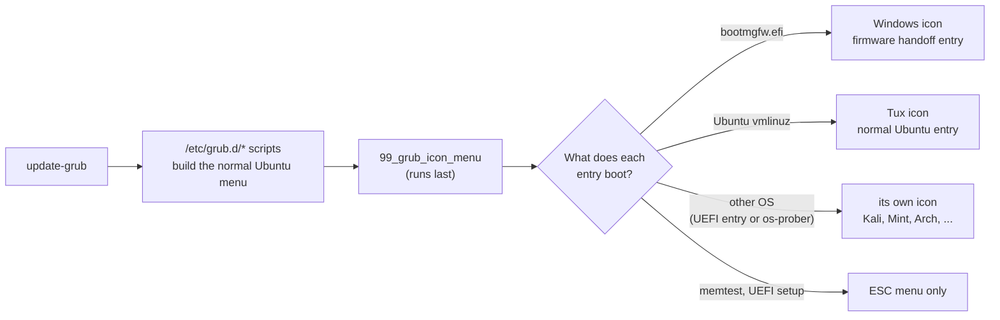

1. `update-grub` builds the normal Ubuntu menu as always.
2. `/etc/grub.d/99_grub_icon_menu` runs last, reads the menu the other scripts just
   generated and classifies every entry by **what it boots**, not by its title:
   - chainloads `\EFI\Microsoft\Boot\bootmgfw.efi` → **Windows**
   - loads an Ubuntu kernel (`vmlinuz`) → **Linux**: all kernels and recovery entries
     share one Tux
   - another Linux found by os-prober (with `--os-prober`) → **its own icon** by name
     (`--class linuxmint`, title "Linux Mint ...")
   - anything else (memtest, firmware settings) → no icon
3. **Windows (firmware mode):** if the UEFI boot entries contain *Windows Boot Manager*,
   the hook adds the entry *Windows Boot Manager (started by the UEFI firmware)*: the
   newest signed kernel + `handoff.img` + `gim.bootnext=<number>`. The Windows icon
   boots this entry. If anything is missing, there is no Windows icon. **It never
   falls back to chainloading.**
4. **Every other system with its own UEFI boot entry** (Kali, Fedora, ...) gets the
   same kind of entry, for example *Kali Linux (started by the UEFI firmware)* with
   `gim.match=/efi/kali/shimx64.efi`. `handoff.img` checks that the boot entry really
   starts that file before it sets `BootNext`. Systems the theme has icons for get
   one. Others are reported and stay in the ESC menu until `update.sh` adds them.
5. **At boot**, GRUB first shows the icon menu, a nested menu loaded from
   `chooser.cfg`. Picking an icon re-enters `grub.cfg` with that icon's **normal**
   entry as the default and a zero timeout. That keeps the default OS,
   `recordfail`, `savedefault`, recovery mode and kernel updates working exactly as
   Ubuntu set them up. While the OS loads, the background picture (or white) stays
   on screen.

**Safety contract of the hook:** it never makes `update-grub` fail and never writes
partial output. On any problem it writes a comment instead, and `grub.cfg` is exactly
what the other scripts produced, which is the normal Ubuntu menu.

## Configuration file

The settings live in `/etc/default/grub.d/99-grub-icon-menu.cfg`, which is sourced by
`update-grub` after `/etc/default/grub`. `install.sh` and `update.sh` write it, and
`/etc/default/grub` itself is never edited. Using `update.sh` is the easiest way to
change a setting. If you edit the file by hand, run `sudo update-grub` afterwards.

| Variable | Meaning |
|---|---|
| `GRUB_ICON_MENU` | `true`: icon menu. `false`: plain text menu, which keeps the BitLocker-safe Windows entry (`update.sh --plain` / `--icons`). |
| `GRUB_ICON_MENU_TIMEOUT` | seconds before the preselected icon boots; `-1` waits forever |
| `GRUB_ICON_MENU_ORDER` | icons from left to right, for example `"windows linux kali"` (at most 6) |
| `GRUB_ICON_MENU_TITLE` | `yes` / `no`: show the `>_GRUB / BOOTMENU` title (rebuild with `update.sh`) |
| `GRUB_ICON_MENU_WINDOWS_BOOT` | `firmware` (BootNext, no recovery key) or `chainload` |
| `GRUB_ICON_MENU_OS_PROBER`, `GRUB_ICON_MENU_FOREIGN_LINUX` | set by `--os-prober`: find and show systems that share Ubuntu's boot folder |
| `GRUB_THEME`, `GRUB_GFXMODE` | the theme of the full (ESC) menu and the resolution the theme was built for. The previous values are recorded as comments. |
| `GRUB_DISABLE_OS_PROBER`, `GRUB_OS_PROBER_SKIP_LIST` | os-prober off in firmware mode, or on with Windows skipped (`--os-prober`) |

## Files and safety

### Files it creates

| Path | What |
|---|---|
| `/boot/grub/themes/grub-icon-menu/` | theme, icons, `background.png`, `handoff.img` |
| `/etc/grub.d/99_grub_icon_menu` | detection hook, run by `update-grub` |
| `/etc/default/grub.d/99-grub-icon-menu.cfg` | settings (see [Configuration file](#configuration-file)) |
| `/var/lib/grub-icon-menu/state` | install state |
| `/var/lib/grub-icon-menu/background.<ext>` | copy of the background picture (only with `-bg`) |
| `~/grub-icon-menu-backup/<date>-<action>/` | backup snapshot before every install, update and uninstall |

`/boot/grub/grub.cfg` is regenerated by `update-grub`.

### What it never touches

* `/etc/default/grub` and the other GRUB scripts
* the EFI System Partition, EFI boot entries, `BootOrder` and Windows Boot Manager
* partitions and disks
* `/boot/grub/grubenv` (boot-time state) and kernels

The only UEFI variable ever written is the one-time `BootNext`. It is written only at
boot, and only when you pick the Windows icon or another system that the firmware
starts. The firmware deletes it after use.

## Backup and restore

Every install, update and uninstall first saves a snapshot to
`~/grub-icon-menu-backup/<date>-<action>/`. Each snapshot includes its own copy of
`restore.sh` and `lib/common.sh`, so a restore does not need this repository:

```bash
sudo ~/grub-icon-menu-backup/<snapshot>/restore.sh ~/grub-icon-menu-backup/<snapshot>
```

`restore.sh` shows the differences, asks for confirmation, puts back
`/etc/default/grub`, `/etc/default/grub.d/*`, `/etc/grub.d/*` and the theme folder,
then regenerates `grub.cfg`. If `update-grub` fails, the snapshot's `grub.cfg` is
copied back instead.

If anything fails during install or update, the changes are **rolled back
automatically**.

## Troubleshooting

The full guide is [docs/help.html](docs/help.html). In short:

1. **The menu looks wrong:** press **ESC** for the full menu, then choose *Ubuntu*.
2. **The Windows icon shows a message instead of restarting:** read it. Windows was not
   started and nothing was changed. Start Windows from the firmware boot menu →
   *Windows Boot Manager*, then run `sudo ./doctor.sh` and `sudo ./update.sh` in Ubuntu.
3. **The laptop boots straight into Windows:** a Windows update probably moved
   *Windows Boot Manager* to the front of the boot order. `sudo ./doctor.sh` prints the
   `efibootmgr` command that fixes it.
4. **Turn it off:**
   - `sudo ./update.sh --plain` (text menu, Windows entry kept), or
   - `sudo ./uninstall.sh`, or by hand:
     `sudo rm /etc/grub.d/99_grub_icon_menu /etc/default/grub.d/99-grub-icon-menu.cfg && sudo update-grub`
5. **GRUB does not show a menu at all:** use the firmware boot menu (F9 on HP, F12 on
   Dell and Lenovo, for example) and pick *Ubuntu* or *Windows Boot Manager*. Those
   entries are untouched.
6. **From a live USB:** mount the installed system and remove the two files from a
   chroot. Below is an example for an encrypted Ubuntu (LUKS on `nvme0n1p5` with LVM
   inside, `/boot` on `nvme0n1p4`, EFI partition on `nvme0n1p1`). **Check your own
   layout with `lsblk -f` first.**

   ```bash
   sudo cryptsetup open /dev/nvme0n1p5 dm_crypt-0    # asks for your disk password
   sudo vgchange -ay
   sudo mount /dev/ubuntu-vg/ubuntu-lv /mnt
   sudo mount /dev/nvme0n1p4 /mnt/boot
   sudo mount /dev/nvme0n1p1 /mnt/boot/efi
   for d in dev proc sys run; do sudo mount --bind /$d /mnt/$d; done
   sudo chroot /mnt rm -f /etc/grub.d/99_grub_icon_menu /etc/default/grub.d/99-grub-icon-menu.cfg
   sudo chroot /mnt update-grub
   ```

## FAQ

<details>
<summary><b>Why does the laptop restart once when I pick Windows?</b></summary>

That restart is how BitLocker stays quiet. Only the firmware can start Windows the way
BitLocker expects, so the Windows icon sets a one-time `BootNext` and restarts. See
[Windows and BitLocker](#windows-and-bitlocker). If you do not use BitLocker and prefer
a direct start, use `--windows-boot chainload`.
</details>

<details>
<summary><b>Why does Left do nothing and Right boot the OS?</b></summary>

GRUB hard-codes its menu keys, and a theme cannot change them. Use Up and Down to move
the arrow, and Enter to boot.
</details>

<details>
<summary><b>Do I need to do anything after a kernel update?</b></summary>

No. `update-grub` runs the hook automatically. The Windows icon always uses the newest
**signed** kernel, so an unsigned mainline kernel cannot break it with Secure Boot on.
</details>

<details>
<summary><b>I installed another distribution and it has no icon.</b></summary>

Run `sudo ./update.sh`. If the distribution shares Ubuntu's boot folder (Linux Mint,
Zorin OS, elementary OS, ...), use `sudo ./update.sh --os-prober`. Until then it is
available in the ESC menu.
</details>

<details>
<summary><b>Can I show the OS names under the icons?</b></summary>

The icon menu shows no names by design. Press ESC for the full menu with names, or
switch to the plain text menu with `sudo ./update.sh --plain`.
</details>

<details>
<summary><b>The icons are too small or too large.</b></summary>

Change `ICON_SCALE` in `scripts/generate-assets.sh` (default `0.6`), then run
`sudo ./update.sh --rebuild`. If the screen resolution is wrong, use
`sudo ./update.sh --resolution WxH`.
</details>

<details>
<summary><b>How do I get the original Ubuntu menu back exactly?</b></summary>

Use the restore script of the snapshot taken at install time; see
[Backup and restore](#backup-and-restore). `uninstall.sh` removes grub-icon-menu but
leaves os-prober off, so Windows is then started from the firmware boot menu.
</details>

## Project layout

```text
grub-icon-menu/
├── install.sh              install (try --dry-run first)
├── update.sh               re-detect systems, change settings, rebuild the theme
├── uninstall.sh            remove it, back to the normal Ubuntu menu
├── restore.sh              restore a backup snapshot exactly
├── doctor.sh               read-only health check: OK / WARN / FAIL + fix
├── inspect.sh              read-only report of the boot setup
├── detect-os.sh            which systems the GRUB menu boots (KEY=VALUE)
├── generate-menu.sh        print the GRUB script update-grub would add
├── grub.d/
│   └── 99_grub_icon_menu   the update-grub hook (detection + menu generation)
├── handoff/
│   └── init                the program inside handoff.img (sets BootNext, restarts)
├── lib/                    shared shell code: common.sh, actions.sh
├── scripts/
│   ├── generate-assets.sh  builds a complete theme for one screen size
│   ├── build-handoff.sh    builds handoff.img (reproducible, no root)
│   ├── render-masters.sh   SVG → PNG icon masters (librsvg)
│   ├── detect-ubuntu.sh    evidence of the running Ubuntu
│   ├── detect-windows.sh   firmware/EFI evidence of Windows and BitLocker
│   └── render-cover.py     the README cover and the GitHub social preview
├── theme/                  chooser.cfg (nested icon menu) and the Tux master
├── icons/                  SVG sources and PNG masters of every logo
├── wallpapers/             ready-made backgrounds and their generator
├── docs/                   screenshots, cover, offline help page (help.html)
└── tests/                  fast tests, sandbox tests, QEMU tests, fixtures
```

## Development and tests

```bash
tests/run-tests.sh                               # fast checks: no root, no VM
tests/sandbox-test.sh                            # full lifecycle with the real update-grub, no root
QEMU_ROOT=<qemu dir> tests/qemu-scenarios.sh     # real GRUB in a VM: keys, background, plain menu, 4 systems
QEMU_ROOT=<qemu dir> tests/qemu-handoff-test.sh  # Secure Boot + TPM: PCR comparison, Kali entry
QEMU_ROOT=<qemu dir> tests/qemu-screenshots.sh   # regenerate the screenshots in docs/
```

| Test | What it covers |
|---|---|
| `run-tests.sh` | shell syntax; detection on fixtures (Windows, Ubuntu, Mint, multi-kernel, BIOS); hook output checked with `grub-script-check`; no OS names in titles; idempotence (byte-identical output); theme generation from 1280x720 to 3840x2160; firmware handoff entry and `handoff/init`; background, icon colour, shadow, sharp edges; `doctor.sh` warnings; other systems |
| `sandbox-test.sh` | install, kernel update, `update.sh` (new resolution, Windows removed and re-added, chainload ↔ firmware, background, plain menu, Kali, Linux Mint), failure + rollback, uninstall, restore. Runs in a bubblewrap namespace against a fake system. |
| `qemu-scenarios.sh` | boots real GRUB in QEMU/OVMF, presses keys and asserts which menu entry was executed |
| `qemu-handoff-test.sh` | end-to-end firmware handoff in a Secure Boot VM with swtpm, comparing the PCR values BitLocker would see |

`QEMU_ROOT` is an extracted tree (`dpkg-deb -x`) of the QEMU, OVMF, swtpm and signed
kernel packages. The header of each test script lists the exact packages.

Useful developer commands:

```bash
scripts/generate-assets.sh --resolution 1920x1080 --out /tmp/theme   # build a theme, install nothing
./generate-menu.sh --cfg tests/fixtures/windows-ubuntu.cfg --theme /tmp/theme
./detect-os.sh --cfg tests/fixtures/ubuntu-mint.cfg -v
scripts/render-masters.sh             # re-render icon masters after editing an SVG
python3 wallpapers/generate.py        # re-render the wallpapers
python3 scripts/render-cover.py       # re-render docs/cover.png and docs/social-preview.png
```

To support a new system, follow [*Adding a system*](icons/README.md#adding-a-system):
add an SVG logo, render the master, teach the hook its name and run the tests.

> **GitHub social preview:** upload `docs/social-preview.png` (1280x640) in
> *Settings → General → Social preview* so links to the repository show the cover.

## Credits and licences

* **OS logos:** [Simple Icons](https://simpleicons.org) 16.34.0 (CC0). Some logos carry
  their own licence, recorded per logo in [`icons/README.md`](icons/README.md). All
  logos are trademarks of their owners and are used only to label the boot entry of
  that system.
* **Tux:** [Tux-icon-mono.svg](https://commons.wikimedia.org/wiki/File:Tux-icon-mono.svg)
  by Cowemoji, Wikimedia Commons, CC0 1.0.
* **Windows logo** and the **generic `>_` icon:** drawn for grub-icon-menu. The Windows
  logo is a trademark of Microsoft and only labels the entry that starts Windows.
* **Screenshot background:** *Red Acer* by mendhak (Ubuntu wallpaper), CC BY-SA 4.0.
* **Fonts on the boot screen:** taken from the fonts installed on your system: Nimbus
  Mono PS for the title (rendered as an image) and DejaVu Sans Mono for the menu text
  (converted with `grub-mkfont`), or similar monospace fonts when these are missing.
